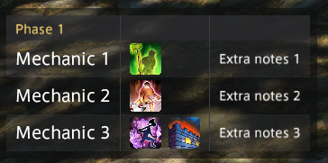

# Duty Notes

An in-game overlay for Final Fantasy XIV that holds your notes for a duty: a table of **mechanics**, the **mitigation
and healing skills** to use for each (shown as icons), notes, and free text. It switches to the right sheet by itself
when you enter the duty, and you can step through the phases of a fight with buttons or macros.

It is a [Dalamud](https://github.com/goatcorp/Dalamud) plugin, built for people who rehearse hard encounters.

> **Status: in development, not yet released.** It runs as a dev plugin and has not been published to any plugin
> repository. See [ROADMAP.md](ROADMAP.md) for what is left and [docs/TESTING.md](docs/TESTING.md) for what has
> and hasn't been verified in game.

> **Made with AI.** This plugin was written by an AI (Claude, by Anthropic), not by a human programmer. The owner directed the work
> and tested it in game. See [AI disclosure](#ai-disclosure) below.



## What it does

- **Sheets of rows.** An *encounter* holds *phases*, and each holds rows. A **mechanic row** has the mechanic's name, the
  skills to use (picked from a searchable list and shown as icons) and optional notes. A **note row** is free text that
  runs across the full width of the table.
- **A smart skill picker.** It offers the skills that exist at the encounter's level, so a level 80 sheet doesn't
  offer Bloodwhetting. Searching any version of a skill finds the one you have (search "Bloodwhetting", get Raw
  Intuition). It filters to your job and to defensive and healing skills by default.
- **Auto-select by duty and job.** Tie an encounter to a duty and a job. Entering that duty on that job selects the
  encounter, opens the overlay if it was hidden and hides it again when you leave.
- **Phases.** Show the whole encounter, or only the phase you are on and step through them with **Reset**,
  **Previous** and **Next** (buttons under the overlay, and chat commands for macros). Switch any phase or row off with a
  tick and it is skipped, without deleting it.
- **Share.** Export an encounter as a short piece of text and import one from someone else, through a paste box.
  An example to try is in [samples/](samples/example-encounter.txt).
- **Looks the way you want.** Text sizes, icon size, column spacing, background, auto-size with an anchor, column headers,
  how each column is aligned, and a right-click menu on the overlay.
- **Help built in.** A Help tab lists the chat commands, with macros and icons to copy for next, prev and reset.

## Install (as a dev plugin)

You need the XIVLauncher with Dalamud installed, and the game.

1. Build the plugin (see [Build](#build)), or get a folder containing `DutyNotes.dll`, `DutyNotes.json` and
   `DutyNotes.deps.json` (that is what a build writes).
2. In game, open `/xlsettings`, go to **Experimental** and add the full path to `DutyNotes.dll` under **Dev Plugin
   Locations**. Use an absolute path. Save.
3. Open `/xlplugins`, then **Dev Tools > Installed Dev Plugins**, and enable **Duty Notes**.

After you rebuild, reload it from that same list.

## Using it

Open the editor with `/dutynotes edit`.

1. **Sheets tab:** add an encounter with **+ Encounter**, and phases with **+ Phase**. Pick its **Duty** and **Job**. The buttons under a sheet's name (Move up, Move down, Duplicate, Export, Delete) act on it; **+ Encounter**, **+ Phase** and **Import** on the left add things.
   **Add mechanic row** and **Add note row** add a row at the end. Right-click the background of any row for a menu: add a mechanic or note row above or below it, duplicate it, or delete it (duplicate and delete are also icons beside its tick). Use **+** on a row to add skills (including **Limit Break**), and drag a row by its background to reorder it. The tick beside a row or phase switches it off.
2. **Settings tab:** behavior (auto-select, auto open, auto hide, cutscenes), layout (including how each column is aligned) and style. Each section
   has a **Reset** button that can be undone.
3. **Help tab:** the chat commands, and macros to copy.
   The overlay starts hidden each time the game starts. Show it with `/dutynotes`, with **Show overlay** in the editor, or let auto-select open it when you enter a duty with a sheet for your job.
4. The overlay itself: right-click it for a menu. Hold **Ctrl** while right-clicking if it is locked.

### Commands

| Command | What it does |
| --- | --- |
| `/dutynotes` | Show or hide the overlay |
| `/dutynotes edit` | Open or close the editor |
| `/dutynotes lock` | Lock or unlock the overlay (locked means click-through) |
| `/dutynotes next` | Go to the next phase |
| `/dutynotes prev` | Go to the previous phase |
| `/dutynotes reset` | Go back to the first phase |
| `/dutynotes full` | Switch between the whole encounter and the current phase |

`/dutynotes previous` also works for `prev`.

The editor's **Help** tab lists these commands, with a copy icon for a suggested macro under the ones worth binding to a hotbar key (next, prev and reset).

### Sharing

**Export** (the button under the encounter's name) copies the selected encounter to the clipboard as text starting with `DutyNotes:1:`.
**Import** opens a box to paste that text into (or press Paste from clipboard), then adds the encounter. Pasted text is checked before use. A ready-made example is in [samples/example-encounter.txt](samples/example-encounter.txt): a made-up encounter with three phases that also shows a note row, a row and a phase switched off, and Limit Break. See [docs/FORMATS.md](docs/FORMATS.md).

## Build

Requirements: Windows, the **.NET 10 SDK**, a XIVLauncher with Dalamud installed, and internet for the first build (the
plugin uses the [Dalamud.NET.Sdk](https://github.com/goatcorp/Dalamud.NET.Sdk), which finds Dalamud and its libraries and
generates the plugin manifest from `DutyNotes\DutyNotes.csproj`).

```powershell
dotnet build DutyNotes\DutyNotes.csproj -c Release
```

The output is in `DutyNotes\bin\Release\`: `DutyNotes.dll`, `DutyNotes.json` (the generated manifest) and `DutyNotes.deps.json`. Copy
those to the folder your dev plugin path points at. A Release build also writes `DutyNotes\bin\Release\DutyNotes\latest.zip`, the package
a plugin repository would serve.

### Tests

The logic that doesn't need the game has an xunit test project (it downloads its NuGet packages on the first build, and uses the Dalamud files from your XIVLauncher install, as the plugin does):

```powershell
dotnet test DutyNotes.Tests -c Release
```

It exits with 0 when everything passes. What it covers, and what it can't, is in [docs/TESTING.md](docs/TESTING.md).

## Documentation

| File | For |
| --- | --- |
| [CLAUDE.md](CLAUDE.md) | Anyone (or any AI session) continuing development: architecture, commands, pitfalls. Written for AI sessions |
| [docs/DECISIONS.md](docs/DECISIONS.md) | Why the plugin works the way it does |
| [docs/FORMATS.md](docs/FORMATS.md) | The export text and settings file formats |
| [docs/GAME-DATA.md](docs/GAME-DATA.md) | What the game's data tables contain and how to look at them |
| [docs/TESTING.md](docs/TESTING.md) | Automated tests, and the checklist for what needs the game |
| [docs/RELEASING.md](docs/RELEASING.md) | How a version is released to players (the custom plugin repository) |
| [ROADMAP.md](ROADMAP.md) | What is planned and what was deliberately left out |
| [CHANGELOG.md](CHANGELOG.md) | What changed |

## AI disclosure

This project was written with AI, and we want that to be clear to anyone who reads, installs or reuses it.

- **Who wrote what.** The source code, the automated tests and the documentation were written by **Claude**, an AI model made by Anthropic,
  working through Claude Code. The repository owner, [notingway](https://github.com/notingway), did not type the code. Their part was
  deciding what the plugin should do and how it should look and behave, giving feedback on every iteration, and testing each feature in
  the game (the checklist of what they confirmed is in [docs/TESTING.md](docs/TESTING.md)).
- **What has been checked.** The logic that doesn't need the game has automated tests (`dotnet test`). Everything that needs the game was
  checked by hand in game by the owner. It has not been independently reviewed by another developer.
- **What that means for you.** It may contain mistakes that a human author would not have made, as well as ones they would. Bug reports
  are welcome (open an issue), and so are corrections.
- **The icon** (`images/icon.png`) was generated with ChatGPT (OpenAI) from a prompt written by the owner, then cropped and resized to 512 pixels.
- **`CLAUDE.md`** is a file written for AI coding sessions, so that work can continue in a new session. It is part of the repository on
  purpose, and not hidden.

This is written to be accurate about how the project was made. It is not a claim of quality in either direction.

## License

[MIT](LICENSE), copyright notingway.

Final Fantasy XIV is a trademark of Square Enix. This plugin is not affiliated with or endorsed by Square Enix.
